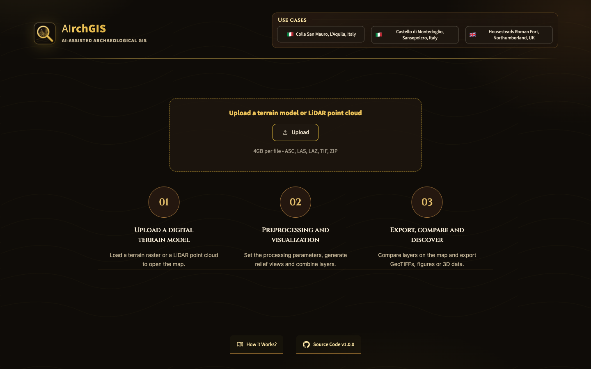
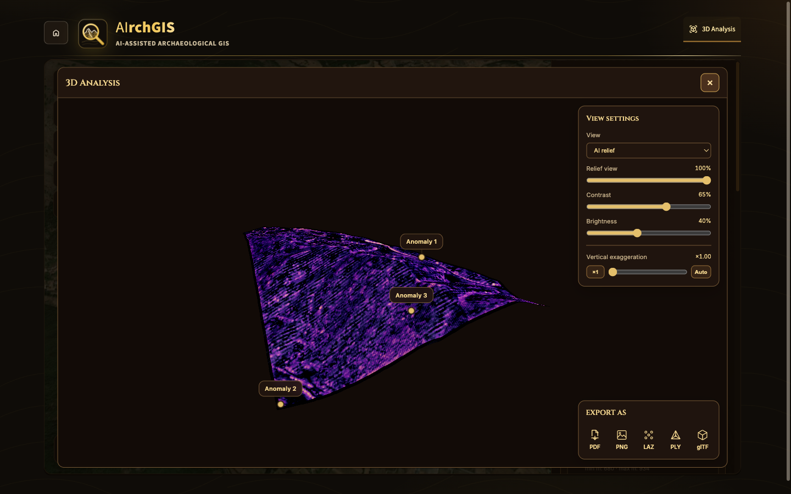
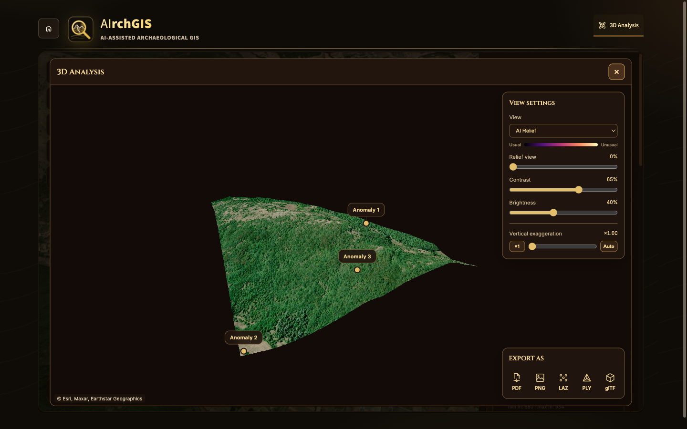

<h1 align="center">
  &nbsp; AIrchGIS
</h1>
<p align="center"><b>AI-assisted archaeological GIS</b></p>

<p align="center">
  
  
  
  
  
  
</p>

AIrchGIS is a local research application for examining digital terrain models and LiDAR point clouds. It combines **[RVT_py relief visualization](https://github.com/EarthObservation/RVT_py)** with an interactive map, 3D terrain analysis and AI-assisted anomaly detection. Load terrain data, compare relief views and export georeferenced results or figures for research.

<p align="center">
  
</p>

- [Quick start](#quick-start)
- [Terrain workflow](#terrain-workflow)
- [3D analysis and export](#3d-analysis-and-export)
- [AI-assisted anomaly detection](#ai-assisted-anomaly-detection)
- [Use cases and references](#use-cases-and-references)
- [Built on RVT_py](#built-on-rvt_py)
- [Reproducibility and project structure](#reproducibility-and-project-structure)

## Quick start

On macOS, double-click `start_airchgis.command`, or run:

```bash
./start_airchgis.command
```

For a manual installation, use Python 3.12 and Git:

```bash
python -m venv .venv_airchgis
source .venv_airchgis/bin/activate
python scripts/install_dependencies.py
streamlit run airchgis_app.py
```

On Windows, replace the activation command with `.venv_airchgis\Scripts\activate`.

Open [localhost:8501](http://localhost:8501). The installer fetches the pinned RVT_py source and installs the application dependencies. It bypasses RVT_py's declared Python `<3.12` restriction for that package only; the application and integration tests have been exercised locally with Python 3.12. GDAL installation may require matching system libraries.

Terrain processing runs locally. Satellite imagery, place labels and global map terrain require internet access. The **How it Works?** button opens the in-app guide.

## Terrain workflow

1. **Upload a digital terrain model.** Load GeoTIFF, ASCII grid, a ZIP of terrain tiles, or LAS/LAZ point clouds. Multiple files are supported, up to 4 GB per file.
2. **Preprocessing and visualization.** Inspect the preparation steps, choose relief methods and compare their output on the map.
3. **Export, compare and discover.** Save numerical rasters, figures or 3D data for further analysis.

Georeferenced rasters in geographic coordinates are reprojected to a metric UTM grid. Compatible raster tiles are joined. Point-cloud preparation uses ground-class points when available and supports TIN, IDW, mean-per-cell and lowest-point gridding. Without a ground classification, all points are used. Small interior gaps can be filled; large missing areas remain outside the terrain surface.

The map opens with hillshade already applied, lit from 315° at a sun elevation of 45°. **Layers** groups the current **Relief view**, **Place** labels and **Base map**, each with visibility and opacity controls. Turning off Base map also turns off Place. A new relief type replaces the current relief; intermediate RVT workspace results remain available.

<p align="center">
  
</p>

**Visualization tools** provides quick relief controls, a feature-width resolution check, AI analysis and access to the full RVT workspace. Light direction uses a slider. The map also supports distance measurement, coordinates and elevation queries. **Home** returns to file upload.

The docked **RVT workspace** keeps the map visible while changing parameters. Live preview updates supported calculations on the loaded terrain grid; **Keep result** retains an output. File and object operations use an explicit run action. Inputs, results, settings, compositions and batch processing are available in the same workspace.

## 3D analysis and export

**3D Analysis** opens an interactive terrain viewer. The terrain occupies its own viewport, with **View settings** in a separate column on the right and **EXPORT AS** below it.

| Control | Behavior |
|---|---|
| **View** | Original, Cloud 1 (points), Cloud 2 (surface, wireframe and points), Cloud 3 (enhanced local relief), or AI Relief |
| **Relief view** | Live opacity from 100% relief to 0% satellite imagery draped on the same terrain |
| **Elevation color** | 0–100%, initially **35%**: adds height-based tint while preserving the grayscale relief luminance; 0% is grayscale. Available in the elevation views, separate from AI Relief scores. |
| **Contrast** | 0–100%, initially **65%** |
| **Brightness** | 0–100%, initially **40%** |
| **Vertical Boost** | Initially **×1**, preserving true proportions; adjustable up to the terrain's **Auto** value |

Satellite imagery follows the terrain grid and is clipped to its valid triangles. NoData areas are omitted, and the background stays transparent. Cloud 3 enhances local relief and therefore changes displayed elevations; original terrain elevations remain available for data export.

<p align="center">
  
</p>

<details>
<summary>Satellite imagery on the same cropped 3D surface, with Relief view at 0%</summary>
<p align="center">
  
</p>
</details>

| Export | Output |
|---|---|
| **PDF / PNG** | The current camera, zoom, rendering, opacity, contrast and exaggeration; transparent background |
| **GeoTIFF** | Numerical relief output from the map, including supported multiband RVT results |
| **LAZ** | Compressed point data from every valid sample of the current terrain grid |
| **PLY** | Full-resolution point data with double-precision coordinates and CRS metadata |
| **glTF** | A binary `.glb` terrain mesh with CRS, local origin and axes in its metadata |

Rendering and image capture use the highest supported resolution up to an 8192-pixel longest edge, bounded by the graphics device and 32 million pixels. PDF embeds the captured image without JPEG compression; it is a raster figure. There is no quality selector. Image size does not add terrain detail: the interactive viewer uses a bounded terrain grid, while LAZ, PLY and glTF exports retain the full current grid without point subsampling or mesh decimation.

## AI-assisted anomaly detection

**Find hidden features (AI)** reads several RVT views together to identify terrain forms that differ from their surroundings. Feature width and sensitivity control the analysis; advanced settings include a random seed and known-feature inputs. The method uses local relief descriptors and a robust statistical model of usual terrain. It does not download a pretrained model or require a GPU for the analysis.

The result adds a score layer and anomaly outlines alongside the relief view. Selecting **AI Relief** in 3D runs the analysis automatically when needed and reuses existing results.

Anomaly labels sit near their terrain markers and follow camera rotation. Hover a label or marker to show its dimensions, local relief and a possible morphological interpretation. Click to focus the camera on it. Interpretations describe shapes compatible with the measured relief; they do not establish an archaeological origin. Modern earthworks, natural forms and data artifacts can also be anomalous.

Known features can be loaded to compare results with individual RVT views and VAT/e3MSTP composites. Synthetic tests cover both favorable and difficult terrain; performance on a particular survey requires independent validation. Implementation and tests are in [`airchgis/ai/`](airchgis/ai/) and [`tests/test_unusual_relief.py`](tests/test_unusual_relief.py).

## Use cases and references

Three terrains are available on the upload screen:

| Use case | Bundled terrain |
|---|---|
| 🇮🇹 **Colle San Mauro, L'Aquila, Italy** | One 1000 × 1000 DTM tile supplied by the user |
| 🇮🇹 **Castello di Montedoglio, Sansepolcro, Italy** | Two adjacent DTM tiles, mosaicked into 2000 × 1000 cells without resampling |
| 🇬🇧 **Betterton, Oxfordshire, UK** | Environment Agency native 1 m DTM, under OGL v3.0 |

The Italian datasets retain their original EPSG:4326 grid at 0.00001° spacing and their NoData values. The app converts them to metric coordinates on load. Each dataset has a `provenance.json` recording source files, processing and checksums. A data license was not included in the supplied Italian archives. The archived Vaassen resolution-test rasters remain under `airchgis/data/use_cases/vaassen/`.

**Site & references** in the map provides historical context and publication links for the Italian sites:

- **Heinzelmann, M., Jordan, D. & Murer, C. (2010).** Amiternum and the upper Aterno valley: a Sabine-Roman town and its territory. *Journal of Roman Archaeology* 23, 55–83. [DOI](https://doi.org/10.1017/S1047759400002300).
- **Vigotti, L. (2021).** Il castello e i possedimenti dei conti di Montedoglio nel 1434. *Pagine Altotiberine* 70, 181–202. ISSN 2039-4861. [Author's publication page](https://www.researchgate.net/publication/389939665_Il_castello_di_Montedoglio_e_i_possedimenti_dei_Conti_di_Montdoglio_nel_1434).

All screenshots above show the current interface using the Colle San Mauro dataset, except the upload screen.

## Built on RVT_py

**RVT_py supplies the relief-visualization algorithms used by AIrchGIS.** The [Relief Visualization Toolbox in Python](https://github.com/EarthObservation/RVT_py) is developed in collaboration between ZRC SAZU and the University of Ljubljana.

AIrchGIS adds file preparation, coordinate handling, map comparison, 3D inspection, anomaly analysis and research exports. Its docked workspace exposes **148 public operations and 468 parameters** across `rvt.vis`, `rvt.blend`, `rvt.blend_func`, `rvt.default` and `rvt.tile`, including visualization, normalization, blending, compositions, settings, raster I/O and tiled processing.

The dependency is pinned to commit [`bab109c`](https://github.com/EarthObservation/RVT_py/tree/bab109c409fedf77ccec7de5fd84c48b791df3d2), package version 2.2.3. The [API coverage inventory](docs/RVT_API_COVERAGE.md) documents the operations and compatibility corrections. Integration tests exercise the listed operations on synthetic terrain; this does not validate every input or parameter combination.

RVT_py uses the [Apache License 2.0](https://github.com/EarthObservation/RVT_py/blob/master/LICENSE). Research using its methods should acknowledge RVT_py and cite the relevant publications from its [References section](https://github.com/EarthObservation/RVT_py#references).

## Reproducibility and project structure

The map's **Script** card downloads the recorded processing steps as Python. Provenance records include parameters, input checksums and software versions. RVT workspace packages retain managed inputs, outputs, arrays, object fields and operation history; they do not automatically restore an interactive session.

Processing runs synchronously on the local computer. Large rasters may require tiled operations or a smaller study area. Browser downloads are limited to 200 MB; larger outputs remain at the local location reported by the app. Map display limits do not change numerical relief calculations or GeoTIFF output.

| Location | Contents |
|---|---|
| [`airchgis_app.py`](airchgis_app.py) | Application entry point |
| [`airchgis/`](airchgis/) | Navigation, upload, map workbench and RVT integration |
| [`airchgis/terrain/`](airchgis/terrain/) | 3D rendering controls, satellite draping and research exports |
| [`airchgis/ai/`](airchgis/ai/) | Relief anomaly analysis and synthetic test terrains |
| [`airchgis/data/use_cases/`](airchgis/data/use_cases/) | Bundled terrains and source metadata |
| [`RVT/`](RVT/) | Terrain processing and browser viewer implementation |
| [`scripts/`](scripts/) | Dependency installation and data-preparation scripts |
| [`tests/`](tests/) | Processing, API, data and export checks |

Third-party attribution is recorded in [`docs/THIRD_PARTY_NOTICES.md`](docs/THIRD_PARTY_NOTICES.md). Further technical notes are in [`docs/AIRCHGIS_STRUCTURE.md`](docs/AIRCHGIS_STRUCTURE.md) and [`docs/RVT_API_COVERAGE.md`](docs/RVT_API_COVERAGE.md).
