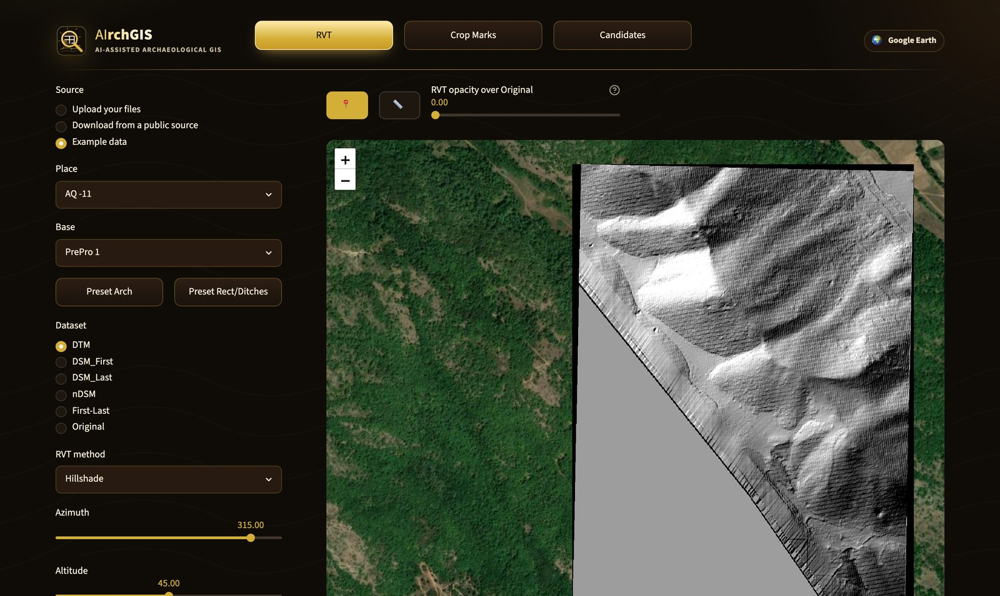

<p align="center">
  
</p>

<p align="center"><b>An AI-assisted archaeological GIS for LiDAR terrain data (DTM, point clouds), on your own data, anywhere in the world.</b></p>

<p align="center">
  
  
  
  
  
  
  
</p>

AIrchGIS brings LiDAR relief visualization, fused views and 3D terrain exploration into one browser app, built for archaeologists with little IT background. You start from your own files (any country, sensor or coordinate system); public elevation models are an optional download. Relief views go on an interactive map where you can compare them, blend them into a fused view and export them as GeoTIFF, open 3D data and figures for papers. Every step is saved as a re-runnable script, and a resolution check tells you when the data cannot show features of the width you are looking for.

<p align="center">
  
</p>

# Table of contents

- [What it does](#what-it-does)
- [Bring your own data](#bring-your-own-data)
- [Tools on the map](#tools-on-the-map)
- [Scripts and provenance](#scripts-and-provenance)
- [3D export for research](#3d-export-for-research)
- [Quick start](#quick-start)
- [Project structure](#project-structure)

# What it does

| Screen | For | What you get |
|---|---|---|
| **Terrain (LiDAR)** | Earthworks, mounds, ditches, terraces under vegetation | Relief visualizations (hillshade, sky-view factor, openness, local relief model, MSRM…), fused view, layer comparison on a map, interactive 3D view, GeoTIFF/PNG and 3D export |

- **Resolution check**: warns when a target is smaller than the data can resolve.
- **Map**: after upload everything happens on a MapLibre map in the style of DetectorLab: tools and layers in the right panel, satellite base, 3D relief, distance measure, UTM coordinates with the elevation of your terrain, Google Earth link.
- **Help**: the **?** button at the top right explains the tool and each feature.

Scores are investigation priorities, not archaeological probabilities.

# Bring your own data

The app starts with **Upload your files** (up to 4 GB per file). Public elevation models are under **Other source**.

- **Terrain**: DTM as GeoTIFF, ASCII grid or zip; LAS/LAZ point clouds, gridded to a DTM from their ground points.

**Download from a public source** is the second option:

| Source | Coverage | Access in AIrchGIS |
|---|---|---|
| Copernicus DEM GLO-30 | Global, 30 m | Automatic, no account |
| OpenTopography | Global DEMs, national LiDAR | Automatic with your API key (kept in `~/.airchgis/config.json`) |
| National LiDAR: England, Netherlands, Denmark, France, Spain, Slovenia, Italy, USA… | National, 0.25–2 m | Link and expected format |

# Tools on the map

The start page only asks for your terrain model or point cloud. Once it is loaded, the map opens with every tool in the **Tools** panel on the right, in the style of the DetectorLab map:

1. **Relief views**: choose a view (hillshade, slope, sky-view factor, openness, local relief model, MSRM…) and its main setting, then **Add to the map**.
2. **Fused view**: after adding two or more relief views, type the width of the features you are looking for; AIrchGIS blends your views with weights that make features of that width stand out most from the noise and from the broad landscape. If the blend is not clearer than the best of your views, it says so and adds nothing.
3. **3D**: the 3D view of your terrain, a high-quality image (PDF or PNG, 300 dpi by default) with the top layer draped on the terrain, and open 3D data (LAZ/LAS, PLY, glTF) for QGIS, CloudCompare or Blender.
4. **Details**: the steps of the session as a Python script.

Each layer can be switched on and off, faded, shown with stronger contrast (display only), downloaded as GeoTIFF or removed. **Load another file** (top of the panel) goes back to the start page. Terrain models in longitude/latitude are reprojected to their UTM zone, so that all sizes are in metres. There is no super-resolution.

Terrain cleaning (banding, spikes and pits, voids, noise) and the automatic best view are available in scripts through `airchgis/gis/tools.py` (`clean_terrain`, `best_view`); they are not in the interface for now.

# Scripts and provenance

Every step runs through `airchgis/gis/tools.py` and is logged with its parameters, input SHA-256, software versions and backend. The log downloads as a Python script that repeats the analysis. QGIS Processing is used through `qgis_process` when installed; otherwise rvt-py and rasterio.

```python
from airchgis.gis import ProvenanceLog, run_tool

log = ProvenanceLog("My survey")
run_tool("relief_view", log=log, input="dtm.tif", output="svf.tif", method="Sky-View Factor", radius_px=10)
run_tool("relief_view", log=log, input="dtm.tif", output="lrm.tif", method="Simple Local Relief Model", radius_px=20)
run_tool("fuse_layers", log=log, input="dtm.tif", layers=["svf.tif", "lrm.tif"], output="fused.tif", target_feature_width_m=5)
log.save_scripts("outputs/")
```

# 3D export for research

In the **3D** card of the map's tools panel, **Download high-quality image** saves the terrain in 3D as a PDF (default, 300 dpi, 190 mm wide, for a paper figure) or PNG, with the top layer draped on it, a scale bar and a north arrow; camera, size and resolution are under *Image options*. **Download open 3D data** writes a georeferenced point cloud (LAZ/LAS and PLY), a terrain mesh (glTF `.glb`) and a JSON sidecar (source, CRS, bounds, resolution, date, relief visualization, vertical exaggeration), zipped for archiving on Zenodo. The files open in QGIS 3D, CloudCompare and Blender. LAZ needs `pip install lazrs`; without it the cloud is written as LAS.

# Quick start

macOS (double-click, or from a terminal):

```bash
./start_airchgis.command
```

Linux and Windows:

```bash
python -m venv .venv_airchgis
source .venv_airchgis/bin/activate    # Windows: .venv_airchgis\Scripts\activate
pip install -r requirements.txt
streamlit run airchgis_app.py
```

The app opens at http://localhost:8501. QGIS is optional.

# Project structure

```text
.
├── airchgis_app.py            # entry point
├── start_airchgis.command     # macOS launcher (creates .venv_airchgis)
├── airchgis/
│   ├── app.py                 # shell and navigation
│   ├── rvt_web.py             # Terrain screen, 3D view, 3D figure and research export
│   ├── help_page.py           # the ? help page
│   ├── map/                   # MapLibre map (interface adapted from DetectorLab, Apache-2.0)
│   ├── data_input.py          # loaders: rasters, LAS/LAZ, site lists
│   ├── input_ui.py            # shared upload input
│   ├── sources.py             # public data sources and downloads
│   ├── enhance/               # fused view and display contrast (cleaning and best view: scripts only)
│   ├── gis/                   # tool registry, QGIS backend, guardrails, provenance, workflows
│   ├── terrain/               # 3D research export (LAZ/LAS, PLY, glTF) and 3D figures (PDF/PNG)
│   ├── benchmark.py           # metrics against known sites
│   └── data/                  # example catalogue, gazetteer, calibration regions
├── RVT/                       # RVT engine, 3D viewer, legacy desktop GUI
├── docs/                      # method notes, benchmarks, assets
├── scripts/                   # benchmark and data-preparation scripts
└── tests/
```

Method notes: [`docs/PHASE0_RESOLVABILITY.md`](docs/PHASE0_RESOLVABILITY.md), [`docs/PHASE_A.md`](docs/PHASE_A.md), [`docs/AIRCHGIS_STRUCTURE.md`](docs/AIRCHGIS_STRUCTURE.md).
