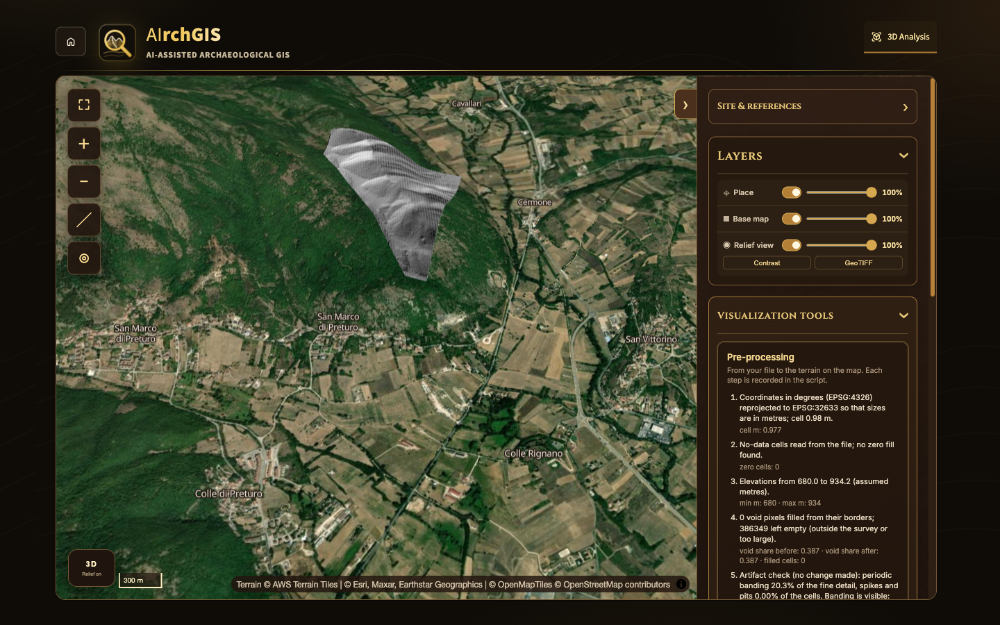

<h1 align="center">
  &nbsp; AIrchGIS
</h1>
<p align="center"><b>AI-assisted archaeological GIS</b></p>

<p align="center">
  
  
  
  
  
  
</p>

AIrchGIS is a local research application for examining digital terrain models and LiDAR point clouds. It combines **[RVT_py relief visualization](https://github.com/EarthObservation/RVT_py)** with an interactive map, 3D terrain analysis and AI-assisted anomaly detection. Load terrain data, compare relief views and export georeferenced results or figures for research.

<p align="center">
  
</p>

- [Quick start](#quick-start)
- [Terrain workflow](#terrain-workflow)
- [3D analysis and export](#3d-analysis-and-export)
- [How AI Relief works](#how-ai-relief-works-find-hidden-features)
- [Use cases and references](#use-cases-and-references)

## Quick start

On macOS, double-click `start_airchgis.command`, or run:

```bash
./start_airchgis.command
```

For a manual installation, use Python 3.12 and Git:

```bash
python -m venv .venv_airchgis
source .venv_airchgis/bin/activate
python scripts/install_dependencies.py
streamlit run airchgis_app.py
```

On Windows, replace the activation command with `.venv_airchgis\Scripts\activate`.

Open [localhost:8501](http://localhost:8501). The installer fetches the pinned RVT_py source and installs the application dependencies. It bypasses RVT_py's declared Python `<3.12` restriction for that package only; the application and integration tests have been exercised locally with Python 3.12. GDAL installation may require matching system libraries.

Terrain processing runs locally. Satellite imagery, place labels and global map terrain require internet access. The **How it Works?** button opens the in-app guide.

## Terrain workflow

1. **Upload a digital terrain model.** Load GeoTIFF, ASCII grid, a ZIP of terrain tiles, or LAS/LAZ point clouds. Multiple files are supported, up to 4 GB per file.
2. **Preprocessing and visualization.** Inspect the preparation steps, choose relief methods and compare their output on the map.
3. **Export, compare and discover.** Save numerical rasters, figures or 3D data for further analysis.

Georeferenced rasters in geographic coordinates are reprojected to a metric UTM grid. Compatible raster tiles are joined. Point-cloud preparation uses ground-class points when available and supports TIN, IDW, mean-per-cell and lowest-point gridding. Without a ground classification, all points are used. Small interior gaps can be filled; large missing areas remain outside the terrain surface.

The map opens with hillshade already applied, lit from 315° at a sun elevation of 45°. **Layers** groups the current **Relief view**, **Place** labels and **Base map**, each with visibility and opacity controls. Turning off Base map also turns off Place. A new relief type replaces the current relief; intermediate RVT workspace results remain available.

<p align="center">
  
</p>

**Visualization tools** provides quick relief controls, a feature-width resolution check, AI analysis and access to the full RVT workspace. Light direction uses a slider. The map also supports distance measurement, coordinates and elevation queries. **Home** returns to file upload.

The docked **RVT workspace** keeps the map visible while changing parameters. Live preview updates supported calculations on the loaded terrain grid; **Keep result** retains an output. File and object operations use an explicit run action. Inputs, results, settings, compositions and batch processing are available in the same workspace.

## 3D analysis and export

**3D Analysis** opens an interactive terrain viewer. The terrain occupies its own viewport, with **View settings** in a separate column on the right and **EXPORT AS** below it.

| Control | Behavior |
|---|---|
| **View** | Original, Cloud 1 (points), Cloud 2 (surface, wireframe and points), Cloud 3 (enhanced local relief), or AI Relief |
| **Relief view** | Live opacity from 100% relief to 0% satellite imagery draped on the same terrain |
| **Elevation color** | 0–100%, initially **35%**: adds height-based tint while preserving the grayscale relief luminance; 0% is grayscale. Available in the elevation views, separate from AI Relief scores. |
| **Contrast** | 0–100%, initially **65%** |
| **Brightness** | 0–100%, initially **40%** |
| **Vertical Boost** | Initially **×1**, preserving true proportions; adjustable up to the terrain's **Auto** value |

Satellite imagery follows the terrain grid and is clipped to its valid triangles. NoData areas are omitted, and the background stays transparent. Cloud 3 enhances local relief and therefore changes displayed elevations; original terrain elevations remain available for data export.

<p align="center">
  
</p>

<details>
<summary>Satellite imagery on the same cropped 3D surface, with Relief view at 0%</summary>
<p align="center">
  
</p>
</details>

| Export | Output |
|---|---|
| **PDF / PNG** | The current camera, zoom, rendering, opacity, contrast and exaggeration; transparent background |
| **GeoTIFF** | Numerical relief output from the map, including supported multiband RVT results |
| **LAZ** | Compressed point data from every valid sample of the current terrain grid |
| **PLY** | Full-resolution point data with double-precision coordinates and CRS metadata |
| **glTF** | A binary `.glb` terrain mesh with CRS, local origin and axes in its metadata |

Rendering and image capture use the highest supported resolution up to an 8192-pixel longest edge, bounded by the graphics device and 32 million pixels. PDF embeds the captured image without JPEG compression; it is a raster figure. There is no quality selector. Image size does not add terrain detail: the interactive viewer uses a bounded terrain grid, while LAZ, PLY and glTF exports retain the full current grid without point subsampling or mesh decimation.

## How AI Relief works (Find hidden features)

**Find hidden features (AI)** in Visualization tools, and the **AI Relief** view in 3D, show the same analysis. It looks for places whose relief does not look like the rest of the same terrain, and for shapes that should not be there: rings, concentric bands, enclosures and curved lines. It only re-analyses the measured terrain. It adds no detail, generates no terrain and uses no data from other places. It runs on the computer with NumPy and SciPy: no GPU and no downloaded model.

Step by step:

1. **Leave out what cannot be read.** Level water surfaces (lakes, the sea) are not analysed and are shown grey. Water is found as large connected areas that are flat at a 15 m scale and keep the same elevation. Clipped DTMs often carry stretched or interpolated data along their border, so there is also an edge strip, 25 m wide by default (adjustable under Advanced):
   - a priority lying mostly in the strip, or running along it as a line, is dropped;
   - a compact, well-formed one that only touches it is kept, with the note "near the edge of the data: check for artefacts".
2. **Read the terrain through several RVT views.** These are sky-view factor, positive and negative openness, the local relief model and slope, computed at the feature width you type, plus the small- and medium-scale relief.
3. **Compare each place with its neighbourhood.** Each view is expressed relative to the terrain around it, so the general shape of the landscape (a hill, a valley) does not count.
4. **Learn the usual relief of this area.** A statistical model of what the views usually look like together is fitted on a random sample of the same terrain, with a fixed seed. The most unusual 10% is left out of the fit, so that features do not shape the idea of "usual".
5. **Score every place.** The score is how far its combination of views is from the usual relief (dark = usual, bright = unusual). With **Also look for larger structures** (on by default), the same is done at three times the feature width on a coarser grid.
6. **Find rings and concentric bands.** Every line of unusual relief "votes" for the points at distance R on both sides of it. A ring makes the votes meet at its centre. Each candidate is then checked by walking around the circle, and it is kept only if:
   - a line of unusual relief follows the circle continuously, running along it;
   - the inside is mostly usual;
   - it beats every one of 100 random circles of the same size drawn on the same terrain.

   The last test makes the threshold adapt to busy terrain such as field systems.
7. **Find stepped bands around hilltops.** Hillforts and castle mounds are often ringed by terraces or ditches that follow the shape of the hill, not a circle. Around each summit at least 8 m high:
   - the terrain is read level by level below the top, in 90 directions;
   - a band is a level where a step, ditch or bank appears in at least 60% of the directions;
   - it must also beat the same measure taken around 40 random points of the same terrain.

   The result is reported as, for example, "1 stepped band around a summit, traced over 77% of its perimeter, about 47 m across".
8. **Rank the priorities to check.** Rings and concentric bands, curved lines and compact forms are ranked by unusualness × (1 + geometry), so rings come first. Long straight lines rank last and are labelled "often a modern road, track, drain or field boundary". They are never removed, because a hidden road can matter too.

The map shows the score, the outlines by kind (orange ring, purple bands around a hilltop, green curved line, red compact form, grey straight line) and the area left out. Each one appears next to the relief view, never instead of it, with a **Before / after** switch. Each priority comes with one sentence, for example "A ring-shaped form about 64 m across, with 2 concentric bands (50, 64 m)…", and the RVT views that drive it.

**Two settings.** The feature width, and the sensitivity, which is the largest share of the area to check (0.5, 1 or 2%; default 1%). A place is listed only if it is also clearly unusual, so a uniform natural terrain can give no priority at all. Under **Advanced** are:
- larger structures on or off;
- the width of the data-edge strip;
- the water options (largest tilt, smallest area);
- the random seed;
- known features (CSV or GeoJSON) to measure, on your terrain, the AUC of the AI layer against each RVT view, VAT and e3MSTP.

**In 3D.** **AI Relief** colours the true terrain by the score and outlines the priorities. Choosing it runs the analysis automatically when needed, with the card's settings, and reuses an existing result for the same terrain and settings. Labels can be hovered for size and shape, and clicked to move the camera there.

**How much to trust it.** These are priorities to check, not sites. Modern earthworks, natural forms and data artefacts can be unusual too. Synthetic tests (`airchgis/ai/synthetic.py`, `tests/test_unusual_relief.py`) show:
- a concentric ringwork on a hill ranks first, with nothing flagged in a lake or on a clipped edge;
- natural terrain gives no priority at the default sensitivity;
- on rough relief with terraces the layer does not beat the best single RVT view or VAT.

Three real terrains were used to design the masks, the ring detector and the hilltop-band detector, so they do not count as an independent test ([`docs/evaluation/`](docs/evaluation/)). Performance on a new survey must be checked against known features.

## Use cases and references

Three terrains are available on the upload screen:

| Use case | Bundled terrain |
|---|---|
| 🇮🇹 **Colle San Mauro, L'Aquila, Italy** | One 1000 × 1000 DTM tile supplied by the user |
| 🇮🇹 **Castello di Montedoglio, Sansepolcro, Italy** | Two adjacent DTM tiles, mosaicked into 2000 × 1000 cells without resampling |
| 🇬🇧 **Betterton, Oxfordshire, UK** | Environment Agency native 1 m DTM, under OGL v3.0 |

The Italian datasets retain their original EPSG:4326 grid at 0.00001° spacing and their NoData values. The app converts them to metric coordinates on load. Each dataset has a `provenance.json` recording source files, processing and checksums. A data license was not included in the supplied Italian archives. The archived Vaassen resolution-test rasters remain under `airchgis/data/use_cases/vaassen/`.

**Site & references** in the map provides historical context and publication links for the Italian sites:

- **Heinzelmann, M., Jordan, D. & Murer, C. (2010).** Amiternum and the upper Aterno valley: a Sabine-Roman town and its territory. *Journal of Roman Archaeology* 23, 55–83. [DOI](https://doi.org/10.1017/S1047759400002300).
- **Vigotti, L. (2021).** Il castello e i possedimenti dei conti di Montedoglio nel 1434. *Pagine Altotiberine* 70, 181–202. ISSN 2039-4861. [Author's publication page](https://www.researchgate.net/publication/389939665_Il_castello_di_Montedoglio_e_i_possedimenti_dei_Conti_di_Montdoglio_nel_1434).

All screenshots above show the current interface using the Colle San Mauro dataset, except the upload screen.

