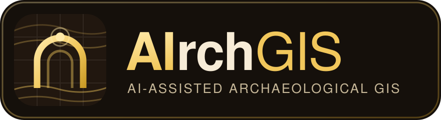
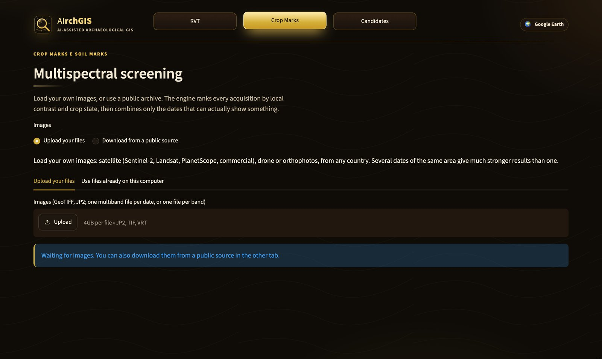

<p align="center">
  
</p>

<p align="center"><b>An AI-assisted archaeological GIS for LiDAR and multispectral prospection, on your own data, anywhere in the world.</b></p>

<p align="center">
  
  
  
  
  
  
  
  
</p>

AIrchGIS brings LiDAR relief visualization, 3D terrain exploration and multi-date screening for crop and soil marks into one browser app, built for archaeologists with little IT background. You start from your own files (any country, sensor or coordinate system); public archives are an optional download. AI assists rather than decides: it calls GIS tools, records every step as a re-runnable script, and says plainly when the data cannot show what you are looking for.

<p align="center">
  
</p>

# Table of contents

- [What it does](#what-it-does)
- [Bring your own data](#bring-your-own-data)
- [Honest limits](#honest-limits)
- [AI and GIS tools](#ai-and-gis-tools)
- [3D export for research](#3d-export-for-research)
- [Quick start](#quick-start)
- [How the field-marks engine works](#how-the-field-marks-engine-works)
- [Project structure](#project-structure)
- [Tests](#tests)
- [Citation](#citation)

# What it does

| Screen | For | What you get |
|---|---|---|
| **Terrain (LiDAR)** | Earthworks, mounds, ditches, terraces under vegetation | RVT relief visualizations (hillshade, sky-view factor, openness, local relief model, MSRM, e3MSTP…), side-by-side comparison, method grid, reports, interactive 3D point cloud |
| **Field marks** | Crop and soil marks of buried features | Date ranking by local contrast and crop phase, per-date anomaly maps, linear marks, persistence across dates, field-boundary mask, check against your known sites |
| **Candidates** | Keeping track of what you found | Verification dossiers that link each anomaly to its evidence, area and status; GeoJSON export |
| **AI assistant** *(in progress)* | Asking in plain language | Tool calling over the GIS layer below: the assistant runs tools, never invents results or coordinates |

Scores are investigation priorities, not archaeological probabilities.

# Bring your own data

Every screen opens on **Upload your files**; you can also point to files already on your computer (no copy, useful for multi-GB tiles). Uploads up to 4 GB.

- **Terrain**: DTM/DSM as GeoTIFF, ASCII grid or zip; LAS/LAZ point clouds, gridded to a DTM from their ground points.
- **Images**: one multiband file per date, or one file per band (`…_B04.jp2`, `…_SR_B4.TIF`). Presets for Sentinel-2, Landsat 4–9, PlanetScope 4/8-band, drone multispectral and RGB orthophotos, plus a band editor. Dates are read from file names and can be edited.
- **Known sites**: your own list (CSV with lon/lat or x/y, GeoJSON, GeoPackage, zipped Shapefile, KML), used as ground truth for every layer (AUC against random controls). A sample catalogue is included only as an example.

**Download from a public source** is the second option:

| Source | Coverage | Access in AIrchGIS |
|---|---|---|
| Copernicus DEM GLO-30 | Global, 30 m | Automatic, no account |
| OpenTopography | Global DEMs, national LiDAR | Automatic with your API key (kept in `~/.airchgis/config.json`) |
| Sentinel-2, Landsat (Google Earth Engine) | Global, from 2016 / 1984 | Processed in Earth Engine, with rainfall and land-cover weighting |
| Copernicus Data Space, Planetary Computer, USGS EarthExplorer | Global | Link and expected format; download, then upload |
| National LiDAR: England, Netherlands, Denmark, France, Spain, Slovenia, Italy, USA… | National, 0.25–2 m | Link and expected format |

# Honest limits

Before any detection, a **resolvability check** compares the width of the feature you are looking for with the pixel size read from your file (sensor blur, pixel averaging and measured field noise). A 5 m Roman street is refused on 10 m Sentinel-2 (SNR ≈ 1.3) and accepted on 3 m imagery; at 10 m, features of about 20 m and more are reliable. When the data cannot answer, AIrchGIS says so and points to LiDAR or very-high-resolution imagery.

# AI and GIS tools

`airchgis/gis/` exposes GIS operations as tools with plain-language descriptions and JSON schemas, ready for LLM tool calling (Claude API, or a local model through Ollama).

- **Backends**: QGIS Processing through `qgis_process` when QGIS is installed (found automatically, or via `AIRCHGIS_QGIS_PROCESS`); otherwise rvt-py/rasterio. Each result says which backend ran. Any QGIS algorithm can be listed and run.
- **Workflows**: *LiDAR micro-relief* (clip, local relief model, sky-view factor, positive and negative openness, hillshade) and *crop-mark screening* (resolvability check first).
- **Provenance**: every run is logged with parameters, input SHA-256, software versions and the exact QGIS command, and saved as JSON, a Python replay script and a shell script.

```python
from airchgis.gis import ProvenanceLog, run_tool

log = ProvenanceLog("My survey")
run_tool("local_relief_model", log=log, input="dtm.tif", output="lrm.tif", radius_m=20, target_feature_width_m=2)
log.save_scripts("outputs/")
```

ArcGIS (`arcpy`) is not supported because it needs a proprietary licence; a backend could be added next to `backend.py`.

# 3D export for research

From the 3D Cloud tab, **Export 3D for research** writes a georeferenced point cloud (LAZ/LAS and PLY), a terrain mesh (glTF `.glb`) and a JSON sidecar (source, CRS, bounds, resolution, date, relief visualization, vertical exaggeration), zipped for archiving on Zenodo. The files open in QGIS 3D, CloudCompare and Blender. LAZ needs `pip install lazrs`; without it the cloud is written as LAS.

# Quick start

macOS (double-click, or from a terminal):

```bash
./start_airchgis.command
```

Linux and Windows:

```bash
python -m venv .venv_airchgis
source .venv_airchgis/bin/activate    # Windows: .venv_airchgis\Scripts\activate
pip install -r requirements.txt
streamlit run airchgis_app.py
```

The app opens at http://localhost:8501. QGIS and a Google Earth Engine project are optional.

# How the field-marks engine works

The ranking does not reward the images with the most variance: field boundaries and different crops produce that, not buried structures. Each date is scored on:

1. **Local contrast**: deviation of each index from its neighbourhood (60 m by default, the scale of a wall or ditch).
2. **Crop phase**: vegetation, bare soil or mixed. Crop marks need a growing crop, soil marks a ploughed field; the *target mark* option decides which dates are combined.
3. **Antecedent dryness** *(Earth Engine only)*: rainfall of the 30 days before each scene against the 1991–2020 ERA5-Land mean.

Anomalies are computed date by date and aggregated afterwards (a median composite would erase transient marks): vegetation deficit and excess, soil marks, linear marks (gradient coherence), persistence and multi-year recurrence. With three or more dates, pixels whose seasonal curve changes shape across a neighbour are masked as field boundaries; a buried feature only shifts the curve, so it is kept.

<p align="center">
  
</p>

# Project structure

```text
.
├── airchgis_app.py            # entry point
├── start_airchgis.command     # macOS launcher (creates .venv_airchgis)
├── airchgis/
│   ├── app.py                 # shell and navigation
│   ├── rvt_web.py             # Terrain screen, 3D Cloud, 3D research export
│   ├── data_input.py          # loaders: rasters, LAS/LAZ, multispectral scenes, site lists
│   ├── input_ui.py            # shared "upload or local path" input
│   ├── sources.py             # public data sources and downloads
│   ├── spectral/              # local field-marks engine and screen
│   ├── cropmarks_engine.py    # Earth Engine engine (Sentinel-2, Landsat)
│   ├── gis/                   # tool registry, QGIS backend, guardrails, provenance, workflows
│   ├── terrain/export3d.py    # LAZ/LAS, PLY, glTF export with metadata
│   ├── candidate_store.py     # verification dossiers
│   ├── benchmark.py           # metrics against known sites
│   └── data/                  # example catalogue, gazetteer, calibration regions
├── RVT/                       # RVT engine, 3D viewer, legacy desktop GUI
├── Crop marks Tool/           # standalone Earth Engine launcher
├── docs/                      # method notes, benchmarks, assets
├── scripts/                   # benchmark and data-preparation scripts
└── tests/
```

Method notes: [`docs/PHASE0_RESOLVABILITY.md`](docs/PHASE0_RESOLVABILITY.md), [`docs/PHASE_A.md`](docs/PHASE_A.md), [`docs/AIRCHGIS_STRUCTURE.md`](docs/AIRCHGIS_STRUCTURE.md).

# Tests

```bash
python -m unittest discover -s tests
```

95 tests, no network needed: loaders, band mapping, local engine (synthetic buried wall), guardrails, tool schemas, provenance replay, 3D export round trip, scene ranking, geocoding and benchmark metrics.

# Citation

A paper describing AIrchGIS is in preparation for *Digital Applications in Archaeology and Cultural Heritage*. Citation details will be added here after publication.
